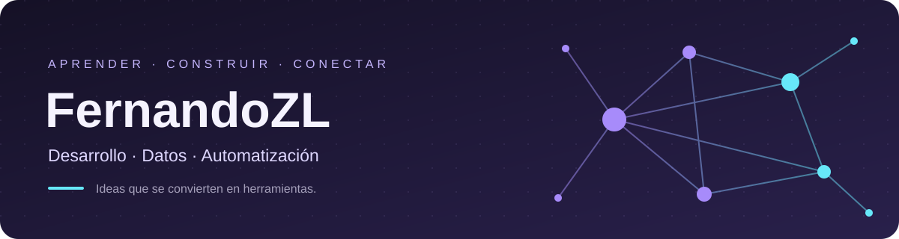
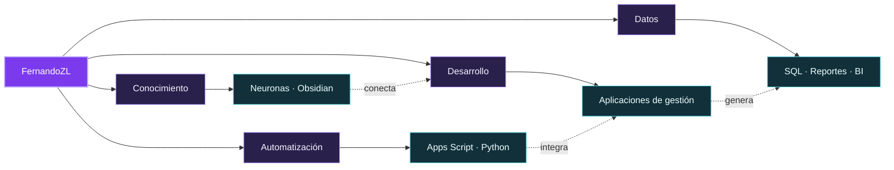
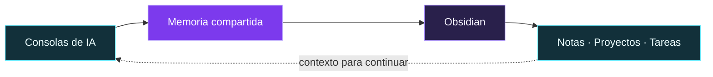

# Hola, soy FernandoZL 👋

### Desarrollo de software · Datos · Automatización

Estudiante de Ingeniería en Sistemas en la Universidad Mariano Gálvez de Guatemala.

Construyo herramientas para organizar información, simplificar procesos y conectar ideas.

[GitHub](https://github.com/FernandoZL) · [LinkedIn](https://www.linkedin.com/in/fernandozl/)

---

## Sobre mí

Soy **FernandoZL**, de Guatemala. Combino mi formación en Sistemas con proyectos de desarrollo web, bases de datos y automatización.

Me interesa trabajar sobre problemas concretos: convertir un proceso manual en una herramienta, hacer que un reporte sea más claro o conectar información que estaba dispersa. Aprendo construyendo, probando y mejorando lo que ya funciona.

## Mi mapa de conexiones

## Lo que construyo

- **Aplicaciones de gestión:** herramientas para caja chica, soporte y seguimiento operativo, con atención a los permisos, la trazabilidad y la experiencia de uso.
- **Datos y reportes:** consultas SQL, preparación de información e indicadores que ayuden a entender una operación.
- **Automatización:** integraciones y flujos con Google Apps Script, Google Workspace y scripts.
- **Herramientas de conocimiento:** Obsidian y memoria compartida para dar continuidad al trabajo entre asistentes de IA.

## Proyecto destacado

### 🧠 [Neuronas para Obsidian](https://github.com/FernandoZL/obsidian)

Un espacio para conectar notas, proyectos, tareas y recuerdos de asistentes de IA dentro de una bóveda de Obsidian.

Incluye memoria compartida entre consolas, captura de conversaciones compatibles y organización del trabajo en Windows y Linux. Las notas permanecen en Markdown para poder consultarlas y editarlas.

**JavaScript · Node.js · Obsidian · MCP**

[Explorar el proyecto →](https://github.com/FernandoZL/obsidian)

## Tecnologías con las que trabajo y aprendo

| Área | Tecnologías |
|---|---|
| Desarrollo | PHP, Java, JavaScript, HTML y CSS |
| Bases de datos | SQL, MySQL, MariaDB y SQL Server |
| Datos | Power BI, ETL y reportes |
| Automatización | Google Apps Script, Google Workspace y Python |
| Entorno | Git, GitHub, NetBeans, VS Code, Windows y Linux |

## En qué estoy enfocado

- Seguir fortaleciendo programación, bases de datos y diseño de aplicaciones durante mi formación universitaria.
- Mejorar herramientas de gestión mediante pruebas, documentación y cambios que se puedan mantener.
- Explorar asistentes de IA como apoyo para programar, investigar y organizar conocimiento.

## Más proyectos

| Proyecto | Explorar |
|---|---|
| 🧠 **Neuronas** · memoria y conocimiento conectado | [Repositorio](https://github.com/FernandoZL/obsidian) |
| 🎓 **PartidasUMG** | [Repositorio](https://github.com/FernandoZL/PartidasUMG) |
| 🐍 **ScriptPy** | [Repositorio](https://github.com/FernandoZL/ScriptPy) |

[Ver todos mis repositorios →](https://github.com/FernandoZL?tab=repositories)

---

**Aprender → Construir → Conectar → Mejorar**

FernandoZL · Guatemala

