  
  

Llegué a los datos desde el comercio exterior y la mejora continua. Cuando hace falta, programo la aplicación que genera la información.

### Trayectoria

### Casos

 **BI corporativo:** almacén analítico y tablero de dirección con semáforos y glosario.

 **Robots en distribución:** tareas repetitivas automatizadas con UiPath y Power Automate.

 **Metas de franquicias:** seguimiento con SQL Server, Odoo y estados bancarios.

 **[Neuronas para Obsidian](https://github.com/FernandoZL/obsidian):** memoria compartida entre asistentes de IA.

El detalle de cada caso está en el portafolio.
