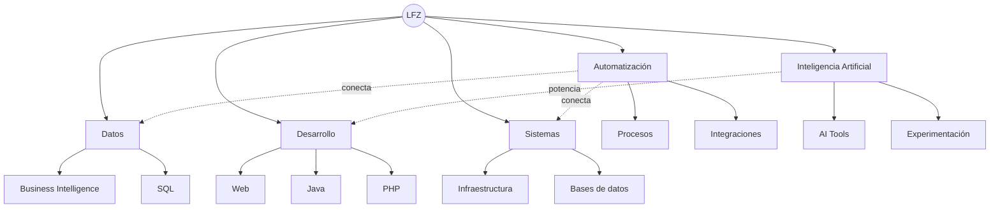

<div align="center">

# Luis Fernándo Zuñiga

### Estudiante de Ingeniería en Sistemas

`Tecnología` · `Desarrollo` · `Datos` · `Automatización` · `IA`

**Aprender · Construir · Conectar · Mejorar**

</div>

---

## `> whoami`

Soy **Luis Fernándo Zuñiga**, estudiante de **Ingeniería en Sistemas**.

Me interesa comprender cómo se conectan la tecnología, los datos y los procesos para convertirlos en soluciones funcionales, ordenadas y útiles.

Mi camino combina desarrollo de software, análisis de datos, automatización, infraestructura y exploración de nuevas tecnologías.

```ts
const lfz = {
  nombre: "Luis Fernándo Zuñiga",
  rol: "Estudiante de Ingeniería en Sistemas",
  enfoque: [
    "Desarrollo de software",
    "Datos y Business Intelligence",
    "Automatización",
    "Sistemas e infraestructura",
    "Inteligencia Artificial"
  ],
  mentalidad: "Aprender → Construir → Conectar → Mejorar"
};
```

---

## `> knowledge_graph`



---

## `> focus`

| Área | En qué me enfoco |
|---|---|
| **Systems** | Arquitectura, infraestructura e integración |
| **Development** | Software, web, backend e interfaces |
| **Data** | SQL, análisis y Business Intelligence |
| **Automation** | Procesos, integraciones y optimización |
| **AI** | Herramientas, agentes y experimentación |
| **Learning** | Ingeniería, tecnología y mejora continua |

---

## `> stack`

```text
Languages      PHP · Java · JavaScript · SQL · HTML · CSS
Databases      MySQL · MariaDB · PostgreSQL · SQL Server
Data & BI      Power BI · ETL · Reporting · Analytics
Tools          Git · GitHub · NetBeans · VS Code · DBeaver
Systems        Windows Server · Apache · Tomcat · Linux
```

---

## `> philosophy`

```text
ENTENDER
   ↓
DISEÑAR
   ↓
CONSTRUIR
   ↓
CONECTAR
   ↓
AUTOMATIZAR
   ↓
MEJORAR
```

> La tecnología tiene más valor cuando conecta información, procesos y personas de una forma clara y útil.

---

## `> connect`

**GitHub:** `@FernandoZL`  
**LinkedIn:** [fernandozl](https://www.linkedin.com/in/fernandozl/)

---

<div align="center">

### `THINK → BUILD → CONNECT → IMPROVE`

**Luis Fernándo Zuñiga · FernandoZL**

</div>
