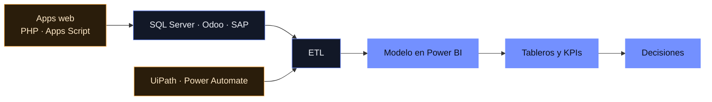

Analista Sr. de **Business Intelligence & TI** en Guatemala. Trabajo con Power BI, SQL Server y RPA, y cuando hace falta programo la aplicación que genera la información. Antes pasé años en comercio exterior y mejora continua; por eso primero entiendo el proceso y después lo mido.

**[Portafolio](https://fernandozl.github.io)** · **[LinkedIn](https://www.linkedin.com/in/fernandozl/)**

## Cómo fluye mi trabajo

## Herramientas

| Área | Stack |
|---|---|
| Business Intelligence | Power BI, DAX, Looker Studio |
| Bases de datos | SQL Server, MariaDB, ETL, Excel avanzado y Power Query |
| Automatización | UiPath, Power Automate, Python, Google Apps Script, PowerShell |
| Desarrollo | PHP, C# y ASP.NET Core, Kotlin, JavaScript |
| ERP | SAP, Odoo |

## Proyectos públicos

| Proyecto | Qué es |
|---|---|
| [Neuronas para Obsidian](https://github.com/FernandoZL/obsidian) | Plugin y servidor MCP que comparten memoria entre asistentes de IA. |
| [Portafolio](https://github.com/FernandoZL/FernandoZL.github.io) | Código de mi sitio personal. |
| [PartidasUMG](https://github.com/FernandoZL/PartidasUMG) | Proyecto universitario. |
| [ScriptPy](https://github.com/FernandoZL/ScriptPy) | Scripts en Python. |

Casi todo lo demás vive en repositorios privados de empresa; el portafolio explica esos casos sin mostrar información interna.
