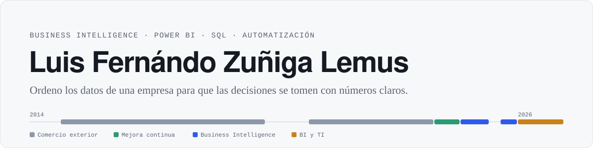

Analista Sr. de BI y TI en Guatemala. Llegué a los datos desde el comercio exterior y la mejora continua, y cuando hace falta programo la aplicación que genera la información.

**[Portafolio](https://fernandozl.github.io)** · **[LinkedIn](https://www.linkedin.com/in/fernandozl/)**

### Trayectoria

| Años | Puesto |
|---|---|
| 2025 – hoy | Analista Sr. Business Intelligence & TI |
| 2025 | Analista de Desempeño y BI |
| 2024 – 2025 | Business Intelligence Operaciones |
| 2023 – 2024 | Analista de Mejora Continua |
| 2014 – 2023 | Comercio exterior |

### Casos

- **BI corporativo:** almacén analítico y tablero de dirección con semáforos y glosario.
- **Robots en distribución:** tareas repetitivas automatizadas con UiPath y Power Automate.
- **Metas de franquicias:** seguimiento con SQL Server, Odoo y estados bancarios.
- **[Neuronas para Obsidian](https://github.com/FernandoZL/obsidian):** memoria compartida entre asistentes de IA, de código abierto.

El detalle de cada caso está en el portafolio.
